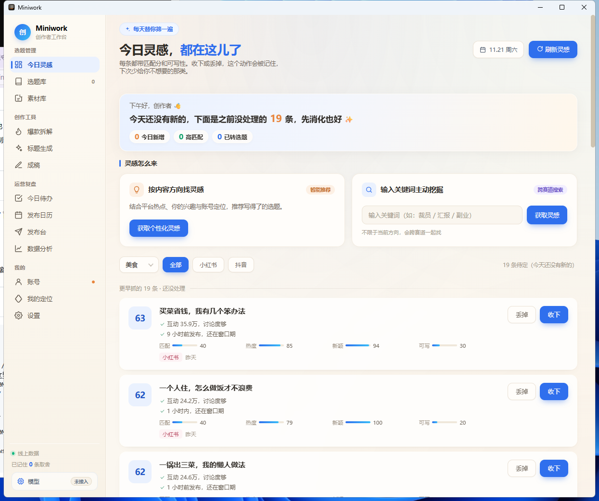
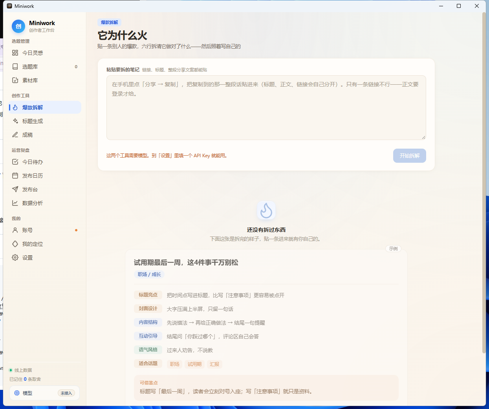
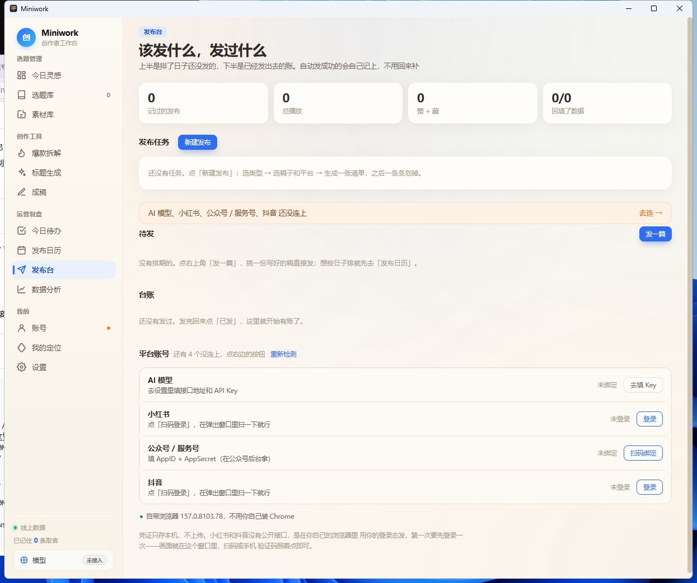
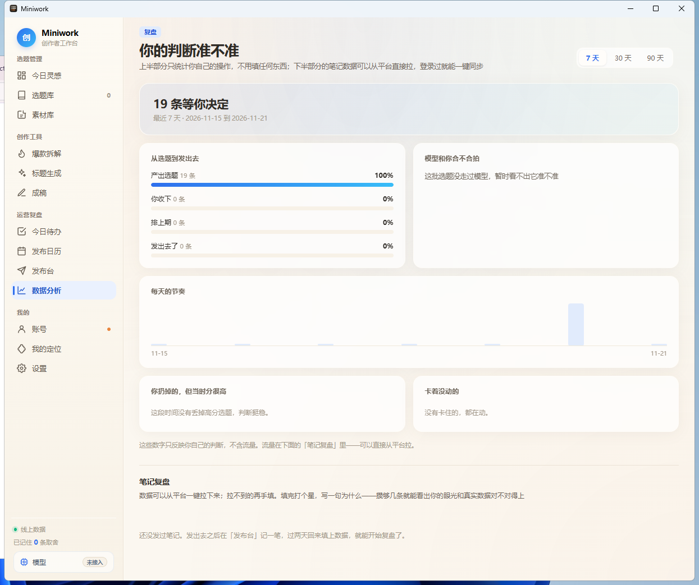

# Miniwork

一个面向内容创作者的桌面端「今日灵感」工作台：按赛道聚合热点、生成选题、管理草稿与发布流程。

- **桌面端**：Wails v3（Go 后端 + 内嵌前端），数据存本地 SQLite
- **数据服务端**：Go 标准库实现，零第三方依赖，单二进制部署
- **开源协议**：MIT

## 运行截图

| 今日灵感 | 爆款拆解 |
|:---:|:---:|
|  |  |

| 发布台 | 数据分析 |
|:---:|:---:|
|  |  |

---

## 功能特性

- 8 个内容赛道（职场 / 美食 / 理财 / 副业 / 健身 / 穿搭 / 育儿 / AI工具）
- 今日灵感：按赛道取热点 → 打分 → 生成待定选题
- 选题库 / 草稿 / 发布流程管理，支持微信公众号
- 人设记忆：赛道跟随人设定位，刷新内容不跑偏
- 数据源可切换：`mock`（内置示例语料）/ `remote`（对接数据服务端）

---

## 目录结构

```
miniwork/
├── app/                    # 桌面客户端（Wails v3）
│   ├── service*.go         # 后端服务层
│   ├── internal/           # config / store / source / pipeline / ai / publish ...
│   ├── frontend/dist/      # 内嵌前端（已编译，直接改这里的 js/html 即可）
│   ├── bin/Miniwork.exe    # 预编译 Windows 客户端（20MB）
│   └── build/              # 各平台打包配置（windows / darwin / android）
├── server/                 # 数据服务端
│   ├── *.go                # 接口 / 语料 / 快照 / 配置
│   ├── config.json         # 公开模板（token 为占位符）
│   ├── miniwork-server.exe # 预编译 Windows 服务端（10MB）
│   └── README.md           # 服务端部署说明
├── 数据接口约定.md / Windows报毒分析与处理.md
├── screenshots/            # 运行截图
└── LICENSE                 # MIT
```

> 浏览器二进制（`app/browser/`，约 813MB）**未随仓库分发**，需自行准备，见下文。
> `账号.md` 是私有密码本，**不在公开仓库中**。

---

## 快速开始

### 方式 A：用预编译 exe（最简单）

1. 安装 [WebView2 Runtime](https://developer.microsoft.com/microsoft-edge/webview2/)（Windows 桌面端的运行前提，缺它程序会直接退出）。
2. 双击 `app/bin/Miniwork.exe` 即可启动。
3. 默认使用内置示例数据（mock）。要看线上数据，按下面「数据源配置」接一个服务端。

> 扫码登录等自动化功能需要内置 Chrome for Testing。仓库不含该二进制，缺失时仅影响这些功能，主界面照常使用；需要时见「准备浏览器依赖」。

### 方式 B：从源码构建

前置：Go 1.27+（国内建议 `GOPROXY=https://goproxy.cn,direct`）。

```bash
cd app
go test ./...                       # 先跑测试，20 个包应全绿
go build -tags production -trimpath -buildvcs=false \
  -ldflags="-w -s -H windowsgui" -o bin/Miniwork.exe .
```

> 前端是 `//go:embed all:frontend/dist` 嵌进 exe 的：**改了 dist 里的 js 必须重新 go build**，否则改动不会生效。

服务端：

```bash
cd server
cp config.json config.local.json    # 改 token
go test ./... && go vet ./...
go build -o miniwork-server.exe .
./miniwork-server.exe -config config.local.json
```

服务端完整部署（systemd / 易撰接入）见 [`server/README.md`](server/README.md)。

---

## 准备浏览器依赖（可选）

桌面端的扫码登录使用 Chrome for Testing 驱动，默认路径：

- Windows：`app/browser/win64/chrome.exe`
- macOS：`app/browser/mac-arm64/Google Chrome for Testing.app/...`

自行下载对应平台的 [Chrome for Testing](https://googlechromelabs.github.io/chrome-for-testing/)（当前验证版本 157.0.8103.78）放到上述目录即可。**不要将浏览器二进制提交进 git**（体积大且含专有组件，已在 `.gitignore` 排除）。

---

## 数据源配置

客户端配置在 `%APPDATA%\miniwork\config.json`（Windows）/ `~/.config/miniwork/config.json`（macOS）：

```json
{
  "source": "remote",
  "remote": {
    "baseUrl": "http://127.0.0.1:18080",
    "token": "<服务端 config 里设的 token>"
  }
}
```

- `source: "mock"` — 内置示例语料，不依赖服务端
- `source: "remote"` — 对接数据服务端，接口契约见 `数据接口约定.md`

启动后左下角数据源角标显示「线上数据」即表示连上了。

---

## 测试

```bash
cd app    && go test ./...    # 客户端 20 个包
cd server && go test ./...    # 服务端 4 个用例
```

---

## 已知限制 / 声明

- 服务端当前使用**内置语料**演示数据来源与刷新机制，**不是真实热榜**。接真数据需替换 `server/corpus.go` 的 `buildSnapshot()` 为易撰 API 适配器。
- 易撰 API 的商业授权、计费、SLA 三件事谈妥前，请勿将其接入商用分发版本（见 `数据接口约定.md`）。
- 本项目不包含任何账号密码、API Key 等凭证；历史配置文件中的 token 均为占位符或本地测试值。
- 内置浏览器、Widevine 等第三方组件有各自的许可证，**需自行获取并遵守其条款**，仓库不代为分发。

---

## License

[MIT](LICENSE) © 2026 Rongsoft
